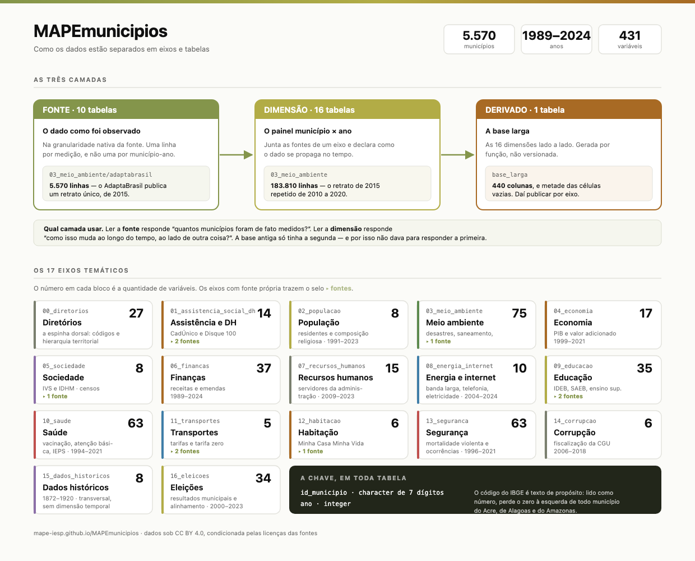

# MAPEmunicipios

<!-- badges: start -->
[](https://lifecycle.r-lib.org/articles/stages.html#experimental)
[](https://github.com/mape-iesp/MAPEmunicipios/actions/workflows/R-CMD-check.yaml)
<!-- badges: end -->

Acesso aos dados do **MAPEmunicipios**: um painel dos 5.570 municípios
brasileiros, de 1989 a 2024, organizado em 17 eixos temáticos e 431 variáveis
documentadas.

**Nenhuma credencial, nenhum cadastro, nenhuma conta em nuvem.**

📊 **[mape-iesp.github.io/MAPEmunicipios](https://mape-iesp.github.io/MAPEmunicipios/)**

## Instalação

```r
# install.packages("remotes")
remotes::install_github("mape-iesp/MAPEmunicipios")
```

## Em cinco linhas

```r
library(MAPEmunicipios)

mape_eixos()                         # os 17 eixos temáticos
mape_variaveis("homicidio")          # procura entre as 431 variáveis
mape_sobre("pib_per_capita_brl2023") # tudo o que se sabe sobre uma delas
mape_ler("saude")                    # baixa e guarda em cache
mape_juntar("seguranca", "populacao", territorio = TRUE)
```

## Como os dados estão organizados



O mesmo dado aparece em duas camadas, e a diferença importa.

A **fonte** guarda o que foi observado, na granularidade nativa. O AdaptaBrasil
publica um retrato de 2015, então `03_meio_ambiente/adaptabrasil` tem 5.570
linhas — uma por município.

A **dimensão** guarda o painel município × ano. `03_meio_ambiente` tem 183.810
linhas, porque repete aquele retrato em onze anos para preencher o painel.

Ler a fonte responde “quantos municípios foram de fato medidos?”. Ler a dimensão
responde “como isso muda ao longo do tempo, ao lado de outra coisa?”.

Na prática, a maior parte das pessoas quer a dimensão — e ela é o padrão.

## O que o pacote faz

**Descobrir.** `mape_eixos()`, `mape_tabelas()`, `mape_variaveis()` e
`mape_sobre()` trabalham sobre dados embutidos, sem tocar a rede. Servem para
achar a variável antes de baixar qualquer coisa.

**Ler.** `mape_ler()` aceita o nome como você lembrar — `"saude"`, `"saúde"`,
`"10_saude"` — e filtra por ano, UF ou município. `territorio = TRUE` traz nome
do município e UF, que nenhuma tabela carrega por decisão de propriedade única.

**Combinar.** `mape_juntar()` confere a cardinalidade antes e **recusa** junções
que produziriam resultado enganoso: tabela com chave duplicada, ou tabela sem
coluna `ano` junta a um painel. Duas tabelas do MAPEmunicipios têm chave
duplicada herdada da fonte, e a função nomeia qual.

**Calcular.** `mape_indicadores()` lista os indicadores derivados;
`mape_calcular()` os calcula com o denominador visível; `mape_ranking()` monta o
ranking de municípios.

## Um exemplo completo

```r
library(MAPEmunicipios)

# Municípios grandes com maior taxa de homicídios em 2019
mape_ranking("taxa_homicidios", ano = 2019, populacao_minima = 200000, n = 5)
#> # A tibble: 5 × 6
#>   id_municipio nome_municipio          sigla_uf   ano taxa_homicidios populacao_residente_i
#>   <chr>        <chr>                   <chr>    <int>           <dbl>                 <int>
#> 1 2408003      Mossoró                 RN        2019            71.6                297378
#> 2 2905701      Camaçari                BA        2019            67.2                299132
#> 3 2602902      Cabo de Santo Agostinho PE        2019            64.7                207048
#> 4 2914802      Itabuna                 BA        2019            63.3                213223
#> 5 1502400      Castanhal               PA        2019            56.8                200793
```

O `populacao_minima` não é conveniência. Numa taxa por 100 mil habitantes, um
único caso em município de três mil pessoas produz 33 por 100 mil — sem piso, o
ranking vira uma lista de municípios minúsculos com um evento cada.

## O que você precisa saber antes de publicar um número

O pacote carrega as ressalvas junto do dado, e `mape_sobre()` as mostra.

**As coberturas vacinais do SI-PNI passam de 100%**, uma delas chegando a
51.175%. A fonte calcula sobre uma população-alvo estimada e não trunca o
resultado. Os valores foram mantidos como a fonte publica.

**Duas tabelas têm chave duplicada.** `06_financas` tem 222, porque as emendas
parlamentares são associadas ao município por nome e sem UF.
`15_dados_historicos` tem 54, que são municípios do Tocantins com registro
anterior e posterior a 1988. As duplicatas foram mantidas de propósito, para que
o problema fique visível.

**O dinheiro está deflacionado.** Quase toda coluna monetária traz `_brl2023`:
reais de dezembro de 2023. A série em valores correntes não existe.

**`id_municipio` é texto.** Lido como número, perde o zero à esquerda de todo
município do Acre, de Alagoas e do Amazonas.

## De onde vêm os dados

O pacote lê de um release público do
[MAPEmunicipios-ETL](https://github.com/mape-iesp/MAPEmunicipios-ETL), que
compila fontes públicas brasileiras: IBGE, DataSUS, INEP, TSE, CGU, SICONFI,
Anatel, SNIS, IPEA, IEPS Data, Anuário do FBSP e AdaptaBrasil.

O código que produz cada número é público, e as decisões de desenho estão
documentadas naquele repositório.

## Licença

Código sob MIT. Dados sob CC BY 4.0, condicionada pelas licenças das fontes.
Três precisam de verificação antes de qualquer uso comercial: IEPS Data, Anuário
do FBSP e o pacote de replicação de Kustov & Pardelli.

## Como citar

```r
citation("MAPEmunicipios")
```

> Schaefer, B.; Meireles, F.; Freitas, C.; Borges, T. P.; Caldas, O.; Barreto,
> L.; Gomes Filho, F.; Mendes, L. **MAPEmunicipios**: painel de dados dos
> municípios brasileiros. MAPE/IESP-UERJ.
