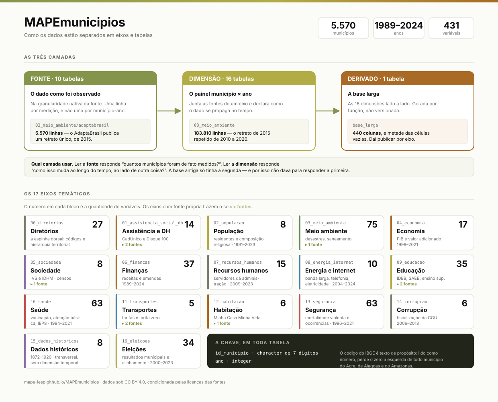

## O esquema

::: {.diagrama}
{fig-alt="Diagrama do MAPEmunicipios com três camadas — fonte, dimensão e derivado — e os 17 eixos temáticos, cada um com a contagem de variáveis"}

O diagrama completo, com as três camadas, os 17 eixos e a chave.
[Baixar em PNG](img/esquema-dados.png).
:::

## As duas camadas, e por que elas existem

Este é o único conceito do MAPEmunicipios que vale entender antes de usar. Ele
custa dois minutos e evita um erro que já saiu publicado.

### A fonte guarda o que foi observado

O AdaptaBrasil publica **um** índice de risco climático por município, medido em
2015. Não é uma série: é um retrato. A tabela `03_meio_ambiente/adaptabrasil`
tem, portanto, **5.570 linhas** — uma por município.

O levantamento de tarifa zero registra 578 município-ano em que a política
esteve vigente. `11_transportes/tarifa_zero` tem **578 linhas**.

### A dimensão guarda o painel

A dimensão `03_meio_ambiente` tem **183.810 linhas**, porque é o painel
município × ano inteiro. O retrato do AdaptaBrasil aparece repetido em onze
anos, de 2010 a 2020, para que a coluna exista em toda linha e possa ser
regredida contra outra coisa.

`11_transportes` tem 183.814 linhas, e a coluna de adesão à tarifa zero está
preenchida com zero em todo município-ano que o levantamento não cobre.

### Qual usar

| a pergunta | a camada |
|---|---|
| Quantos municípios adotaram tarifa zero? | **fonte** |
| Quantos municípios foram de fato medidos pelo AdaptaBrasil? | **fonte** |
| A adesão à tarifa zero cresce com o PIB per capita? | **dimensão** |
| Como o IDEB evolui ao lado do gasto em educação? | **dimensão** |

A base antiga do MAPEmunicipios só tinha a dimensão. Por isso a resposta à
primeira pergunta era "5.570 municípios, todos os anos" — o zero de
preenchimento era indistinguível de um zero medido.

::: {.callout-note appearance="simple"}
Na prática, **a maior parte das pessoas quer a dimensão**. Ela é o padrão de
`mape_ler("transportes")`. A fonte se pede explicitamente, com a barra:
`mape_ler("transportes/tarifa_zero")`.
:::

## O catálogo completo

Filtre por camada, eixo ou texto. Clique numa linha para ver a descrição.

```{ojs}
//| echo: false
catalogo = FileAttachment("dados/catalogo.json").json()
variaveis = FileAttachment("dados/variaveis.json").json()
eixos = FileAttachment("dados/eixos.json").json()
```

```{ojs}
//| echo: false
viewof camadaSel = Inputs.radio(["todas", "dimensao", "fonte"],
  {label: "Camada", value: "todas"})
viewof buscaTab = Inputs.text({label: "Buscar", placeholder: "saúde, emendas, IDEB..."})
```

```{ojs}
//| echo: false
semAcento = s => (s ?? "").normalize("NFD").replace(/[̀-ͯ]/g, "").toLowerCase()

tabelasFiltradas = catalogo.filter(d => {
  const okCamada = camadaSel === "todas" || d.camada === camadaSel;
  const alvo = semAcento(buscaTab).trim();
  const okBusca = !alvo || semAcento(
    `${d.slug} ${d.nome_publicado} ${d.descricao} ${d.fonte_original}`
  ).includes(alvo);
  return okCamada && okBusca;
})
```

```{ojs}
//| echo: false
html`<p style="color:rgba(16,16,16,.62);font-size:.9rem;margin:.4rem 0 .8rem">
  <strong>${tabelasFiltradas.length}</strong> de ${catalogo.length} tabelas
</p>`
```

```{ojs}
//| echo: false
//| column: page
// O container com overflow-x é necessário: a tabela é mais larga que o corpo
// do texto, e sem ele as últimas colunas ficam cortadas em vez de roláveis.
html`<div class="tabela-rolagem">${
  Inputs.table(tabelasFiltradas.map(d => ({
    Tabela: d.slug,
    Camada: d.camada,
    Nome: d.nome_publicado,
    Linhas: d.linhas,
    Colunas: d.colunas,
    Municípios: d.municipios,
    Anos: d.ano_min == null ? "—" : `${d.ano_min}–${d.ano_max}`,
    Fonte: d.fonte_original
  })), {
    rows: 30,
    layout: "fixed",
    format: {
      Linhas: x => x.toLocaleString("pt-BR"),
      Municípios: x => x.toLocaleString("pt-BR")
    },
    width: {
      Tabela: 216, Camada: 86, Nome: 330, Linhas: 84, Colunas: 76,
      Municípios: 96, Anos: 96, Fonte: 220
    }
  })
}</div>`
```

## Procure uma variável

As 431 variáveis, com unidade e faixa observada. A busca ignora acento e exige
todas as palavras.

```{ojs}
//| echo: false
viewof eixoSel = Inputs.select(
  ["todos", ...new Set(variaveis.map(d => d.dimensao).filter(d => d))].sort(),
  {label: "Eixo", value: "todos"}
)
viewof buscaVar = Inputs.text({label: "Buscar", placeholder: "homicídio, vacina, receita..."})
```

```{ojs}
//| echo: false
varsFiltradas = variaveis.filter(d => {
  const okEixo = eixoSel === "todos" || d.dimensao === eixoSel;
  const termos = semAcento(buscaVar).trim().split(/\s+/).filter(t => t);
  const onde = semAcento(`${d.nome_canonico} ${d.descricao}`);
  const okBusca = termos.every(t => onde.includes(t));
  return okEixo && okBusca;
})
```

```{ojs}
//| echo: false
html`<p style="color:rgba(16,16,16,.62);font-size:.9rem;margin:.4rem 0 .8rem">
  <strong>${varsFiltradas.length}</strong> de ${variaveis.length} variáveis
</p>`
```

```{ojs}
//| echo: false
//| column: page
html`<div class="tabela-rolagem">${
  Inputs.table(varsFiltradas.map(d => ({
    Variável: d.nome_canonico,
    Tabela: d.tabela,
    Descrição: d.descricao,
    Unidade: d.unidade,
    Mínimo: d.minimo,
    Máximo: d.maximo,
    "% vazios": d.pct_na
  })), {
    rows: 25,
    layout: "fixed",
    format: {
      Mínimo: x => x == null ? "—" : x.toLocaleString("pt-BR", {maximumFractionDigits: 2}),
      Máximo: x => x == null ? "—" : x.toLocaleString("pt-BR", {maximumFractionDigits: 2}),
      "% vazios": x => x == null ? "—" : x.toFixed(1) + "%"
    },
    width: {
      Variável: 268, Tabela: 176, Descrição: 380, Unidade: 116,
      Mínimo: 96, Máximo: 100, "% vazios": 88
    }
  })
}</div>`
```

## Como ler um nome de variável

Todo nome segue o mesmo padrão:

```
[prefixo_da_fonte_]conceito[_qualificador]_sufixo
```

O **sufixo** diz a escala, e isso não é convenção decorativa: é o que permite ao
pipeline provar que toda coluna terminada em `_pct` está entre 0 e 100.

| sufixo | escala | exemplo |
|---|---|---|
| `_i` | contagem | `sim_obitos_homicidio_i` |
| `_pct` | percentual de 0 a 100 | `ieps_cobertura_esf_pct` |
| `_prop` | proporção de 0 a 1 | `censo_catolicos_prop` |
| `_razao` | quociente que pode passar de 1 | `area_desmatada_sobre_area_municipio_razao` |
| `_p100k` `_p1k` `_p100dom` | taxa, com o denominador no nome | `ieps_medicos_p1k` |
| `_brl_nominal` `_brl2023` | dinheiro, com a base no nome | `pib_brl2023` |
| `_km` `_km2` | distância e área | `area_desmatada_bioma_cerrado_km2` |
| `_idx` | índice ou escore | `ivs_idx` |
| `_cat` | categoria | `adapta_risco_seca_cat` |
| `flag_` | binária (prefixo) | `flag_adota_tarifa_zero` |
| `ano_ref_` | ano de referência que não é a chave | `ano_ref_ideb` |

O **prefixo de fonte** é obrigatório quando mais de uma fonte mede o mesmo
conceito. Cobertura vacinal é medida pelo SI-PNI e pelo IEPS, com denominadores
diferentes — por isso existem `pni_cobertura_bcg_pct` e
`ieps_cobertura_vacinal_bcg_pct`, e comparar as duas exige saber disso.

Morte violenta tem o mesmo problema: o SIM registra óbito e cobre os 5.570
municípios; o Anuário do FBSP registra ocorrência policial e cobre 27. Daí
`sim_obitos_homicidio_i` e `fbsp_homicidio_doloso_i`.

## O que você precisa saber antes de publicar um número

Estas ressalvas estão no dicionário e aparecem em `mape_sobre()`. Elas não são
letras miúdas: são defeitos conhecidos que mudariam a manchete.

### As coberturas vacinais passam de 100%

O SI-PNI calcula cobertura sobre uma população-alvo **estimada**, que é
subestimada em municípios pequenos e em campanhas com público flutuante. A fonte
não trunca o resultado. O máximo observado é **51.175%**.

Os valores foram mantidos como a fonte publica, e não corrigidos — corrigir
exigiria decidir o denominador certo, o que é pesquisa e não limpeza de dado.

### Duas tabelas têm chave duplicada

`06_financas` tem 222 chaves duplicadas porque as emendas parlamentares são
associadas ao município **por nome, sem UF**. De 11.649 linhas, 1.067 têm UF
divergente.

`15_dados_historicos` tem 54, que são municípios do Tocantins com registro
anterior e posterior a 1988.

As duplicatas foram **mantidas de propósito**, para que o problema fique
visível. `mape_juntar()` se recusa a juntar essas tabelas e diz qual é a
responsável.

### O dinheiro está deflacionado, e o nominal não existe

Quase toda coluna monetária traz o sufixo `_brl2023`: são reais de dezembro de
2023, deflacionados pelo IPCA. A série em valores correntes **não existe** no
repositório — o pipeline antigo gravava o valor deflacionado por cima do
original, com o mesmo nome.

O único par que sobreviveu está na Saúde:
`ieps_despesa_saude_total_per_capita_brl_nominal` e a irmã `_brl2023`.

### Cobertura não é o que a fonte declara

O Censo da Educação Superior declara cobrir 1995–2023 e entrega 2009–2023. O
Anuário do FBSP cobre 27 municípios, não o país. Por isso o catálogo separa
**cobertura declarada pela fonte** de **cobertura observada na tabela** — a
segunda é medida no arquivo a cada publicação.

## De onde vêm os dados

O MAPEmunicipios compila fontes públicas brasileiras: IBGE, DataSUS, INEP, TSE,
CGU, SICONFI, Anatel, SNIS, IPEA, além do IEPS Data, do Anuário Brasileiro de
Segurança Pública e do AdaptaBrasil.

A base compilada está sob **CC BY 4.0**, condicionada pelas licenças das fontes.
Três precisam de verificação antes de qualquer uso comercial: IEPS Data, Anuário
do FBSP e o pacote de replicação de Kustov & Pardelli.

O código que produz tudo isso é público, e as decisões de desenho estão
documentadas: [MAPEmunicipios-ETL](https://github.com/mape-iesp/MAPEmunicipios-ETL).
